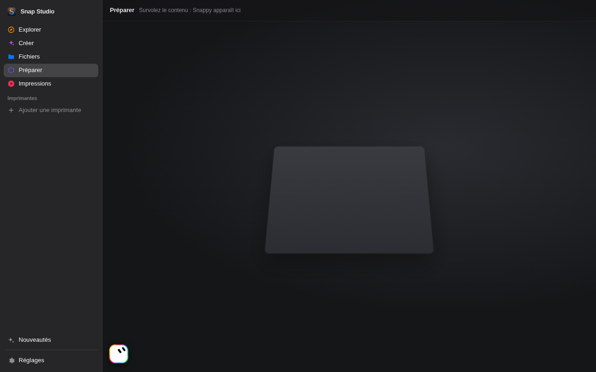
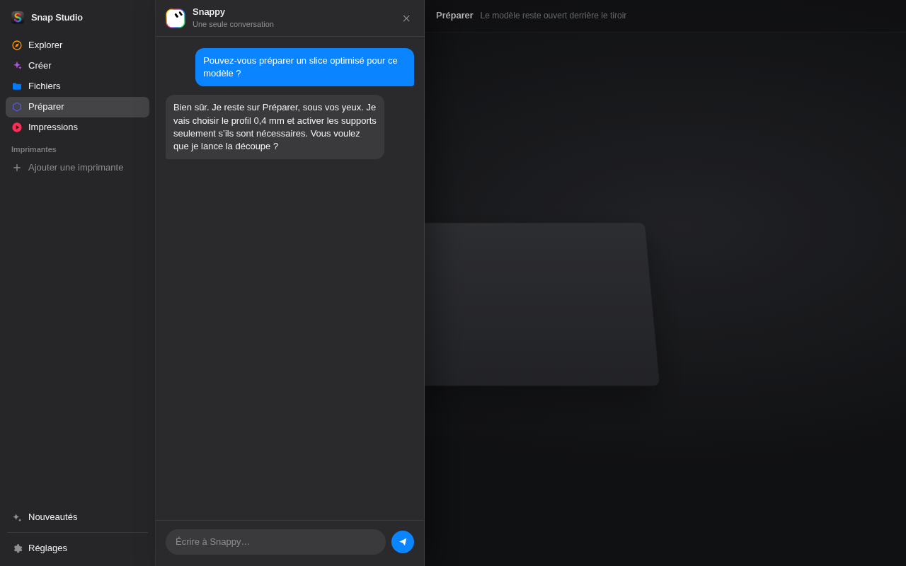

# Snappy — in-app workshop assistant

Status: merged in [#95](https://github.com/kameka22/snap-studio/pull/95) (`d31cc6712a7265d882b4173ee451cce7e9b4a415`). The placement below is the permanent icon and the floating card. The hover icon and the drawer were superseded on 2026-11-05; their mockups are history, not screenshots. See [Implementation notes](#implementation-notes).

## What it is

Snappy is a single, persistent workshop assistant inside Snap Studio: one shared conversation with durable memory. It uses the LLM already configured in the app and drives the app's features through its MCP tools (printers and their files, the queue, Prepare and slicing, the Files view, Create, Explore, Settings), every change confirmed by the user.

It is distinct from the existing object-specific AI chats in Create (`data-view="ia"`).

## Placement

As implemented (owner's decisions, 2026-11-05; see the Implementation note "Icon and avatar"):

- A small, nameless icon, always there, at the right end of the sidebar's separator, between What's new and Settings. The separator line stops short of it (it runs full width when Snappy is off; the macOS theme has no line there).
- No dark plate or circular chrome behind it: only the avatar, transparent around it. No name ("Snappy" or other) is written next to it.
- Click: a conversation card opens beside the sidebar, apart from it, with rounded corners, its bottom level with the icon and a tail pointing at it, over the current view (e.g. Prepare), so the user stays on that page. The icon stays in place, whole, while the card is open.
- The card has no title bar: a close button (×), a width toggle (twice as wide, or back) and New conversation in its corner.
- The icon, the × or a click outside the card closes it.
- Beside the slice sheet (which blurs the app), the icon and the card move into the sheet's layer (Implementation note "Beside the slice sheet").

The first mockups, superseded on 2026-11-05 (a hover-only icon on the content's bottom-left, a drawer against the sidebar), kept as history:

| First mockup: icon on hover | First mockup: drawer open |
| --- | --- |
|  |  |

## Avatar

Rounded square with a pronounced corner radius, white face, and a rainbow outline using the What's new colors (`#FFCC00`, `#FF3B30`, `#AF52DE`, `#0A84FF`, `#30D158`). No toolhead strokes. As implemented, it is drawn in CSS 3D and alive (Implementation note "Icon and avatar"): two upright pill eyes centered and facing front, a volume, the body turning towards the pointer, gestures at rest, a turn about its vertical axis while Snappy works.

The first drawing (two tilted oval eyes), superseded on 2026-11-05:

## Copy

French UI copy uses formal « vous » (not « tu »).

## Privacy and safety

- Never send printer serials, filesystem paths, IPs, hostnames, or similar identifiers to the LLM.
- Irreversible actions require user confirmation.

## Shared Claude launch engine (Create and Snappy)

One engine serves every AI surface: Create's object conversations and Snappy. It follows the same idea as workspaces-manager's `claude_pty::run_claude_via_pty`.

### Never `claude -p`

Snap Studio stops using `claude -p`, for Create as well as for Snappy:

1. It bills against API credits instead of the subscription.
2. It skips the folder trust prompt.
3. It silently ignores an invalid settings file.
4. Launched from a piloted session, it inherits neither that session's permissions, nor its hooks, nor its branch safeguards.

Create today launches `claude -p --input-format stream-json …` from `src-tauri/src/chat.rs`. That launch loop is replaced by the shared engine; `-p` is not kept alongside. Create's workshop around the object stays as it is: workspaces, `CLAUDE.md`, the 3MF tools in `src-tauri/src/ia_tools/`, `chat.jsonl`, the sandbox `--settings`, yolobox, and the conversation UI in `ui/ia-chat.js`.

### Principle

Claude's stdout is never read. Claude runs in its normal interactive mode inside a PTY. Two hooks drop sentinel files, and the reply is read from Claude's JSONL transcript, polled in a loop.

Transcript blocks (`text`, `thinking`, `tool_use`, `tool_result`) are re-emitted as stream-json lines, so the existing chat view keeps its format. A shared `seq` counter keeps chronological order. Token usage also comes from the transcript.

The `-p` / stdout loop of `chat.rs` is not reused. From `pty.rs` (today only used for `claude auth login`, streaming the screen to the UI) we keep the `portable_pty` primitives: open, write, close. The conversation's source of truth is the files, not the terminal screen.

### Launch

- Interactive `claude` in a PTY, with the prompt as a positional `execve` argument, submitted automatically.
- Flags: `--permission-mode`, then as needed `--resume` or `--session-id`, `--model`, `--append-system-prompt`.
- The prompt is capped at 128 KiB (Linux limit on one `execve` argument). Over `MAX_PROMPT_ARG_BYTES`, the app refuses before launching.
- PID: a wrapper `echo $$ > /tmp/claude-turn-<run>.pid ; exec claude …` records it. That pid is also the process group, so a single `kill -TERM -<pid>` stops Claude, its agents and its background shells.
- A new turn imposes its id (`--session-id`), so its transcript `<id>.jsonl` can be named before the SessionStart hook answers. The app never picks "the most recent transcript": doing so mixed neighbouring conversations.
- Engines are the app's existing ones:
  - local: the host binary;
  - built-in sandbox: host Claude with the existing sandbox `--settings`, the hooks merged into those settings (not replacing them);
  - container: yolobox.

### Hooks

Set through `--settings`:

| Hook | File written | What it gives |
| --- | --- | --- |
| SessionStart | start sentinel | official `session_id` and exact `transcript_path` |
| Stop | `/tmp/claude-done-<run>.json` | "the message is complete", with `last_assistant_message` |

### Reading the transcript

- Cadence: every 400 ms during a turn, every 1.5 s while the CLI stays open at rest.
- Local and built-in sandbox: the files are read directly on the host.
- Container: one `docker exec` per pass brings back the three contents (start sentinel, transcript, Stop sentinel), separated by markers `---SS-{START,TRANSCRIPT,SENTINEL}-<run>-<nonce>---`, with a random nonce per turn. A marker only counts when it starts a line. Agent-written content is always inside JSON, which never starts a line with `---SS-`, so an agent quoting the markers cannot split the read.
- workspaces-manager runs `docker exec` in a long-lived workspace container. yolobox may not be that kind of container: container-mode collection follows however yolobox exposes the filesystem.
- Resume: with `--resume` the transcript holds the whole conversation. The app counts its lines before launching (`baseline_lines`) and only reads what comes after.
- Incremental read: if (path, size, mtime) has not changed, nothing is transferred. Otherwise reading resumes at the last byte offset, after checking the SHA-256 of the preceding 4 KiB. When in doubt, it rereads from the start point.

### End of turn

A turn is delivered once, and only with one of two proofs:

1. the Stop hook file, validated as real JSON from that hook;
2. failing that, the transcript's `turn_duration` record, when the sentinel is missing.

An agent team still running keeps the turn open; it then closes as a success.

### CLI kept open between messages

The CLI stays at its prompt from one reply to the next. The next message is typed into the PTY (`inject_prompt`) without relaunching Claude. Before writing, `inject_prompt` increments a pending counter and deletes the Stop sentinel, so the already-answered message cannot close the new turn.

### App close

First cut: no host "keeper" process and no `state/detached-turns/`. Closing the app stops the turn in flight; the next launch resumes the conversation with `--resume`. Keeping Claude alive across an app close (as workspaces-manager does) is deferred.

## Create: migration notes

- Unchanged: object workspace, `CLAUDE.md`, 3MF tools, `chat.jsonl`, sandbox settings, yolobox, conversation UI. Only the launch changes.
- The first user request stays the positional prompt; the workspace `CLAUDE.md` stays the object instructions.
- Permission cards: today they go through stdout (`--permission-prompt-tool stdio`), which is tied to `-p`. The switch needs an equivalent for the permission requests Claude still raises, above all Bash in "This computer" mode. In the built-in sandbox and in the container they are already auto-allowed or skipped (yolobox adds `--dangerously-skip-permissions`).
- Trust prompt: interactive mode asks to trust each new folder. Object folders (and Snappy's folder) are created by the app, so the app pre-trusts those, and only those — never the user's home.
- Images: today sent as base64 JSON content blocks on stdin. The interactive prompt is one text argument (128 KiB cap), so an attachment is written under `attachments/` and mentioned in the prompt.
- Terminal view: shows the same PTY instead of starting a second process. The screen is a view, not the source of truth for the conversation.

## Snappy: tools, approval, memory

Taken from workspaces-manager's bots, simplified to one assistant.

### Identity

Each turn carries Snappy's identity: role, instructions, approval rule, memory, and a sanitized snapshot of the app context (current view, selected printer by display name, Prepare / slice summary). The prompt says who Snappy is, never the list of what it can do: actions are described only by the tools.

`--append-system-prompt` applies at launch only. Since the CLI stays open, updated memory and context travel with each injected user message, and Snappy can re-read `MEMORY.md` through a tool. Otherwise only the first turn would be fresh.

### Local MCP server

- An MCP server inside the app process, authenticated by a token.
- The MCP config is written to a `0600` file, never passed on the command line (where `ps` would show it).
- Five methods: `initialize`, `tools/list`, `tools/call`, plus two service methods.
- Tools are known at compile time: a static Rust table (declaration + handler) replaces publishing tools from the UI. `rmcp` is optional.
- Tool contract: name, description, JSON schema of the parameters, approval required or not; execution in Rust.
- Long operations (slice, send to printer): the tool answers at once with a task id, which Snappy follows or cancels.
- Dynamic tool publishing can come later with the plugin system; it is not needed now.

### Approval

Approval is a server-side barrier, not Claude's permission prompt (which the container skips). A call to a tool marked "approval required" is suspended and a confirmation card appears at the bottom of the drawer. Anything that is not an explicit yes is a no: refuse clicked, drawer closed, or timeout (15 minutes at most). This is what guards starting a print or deleting a file. Each tool has a simple boolean, no autonomy levels.

### Security boundary

Snappy does not get Create's object-workspace file and Bash tools. Bash, Write and Edit are disabled or confined to Snappy's folder, without network. Snappy talks to the workshop only through MCP.

### Privacy filter

Everything sent to the model — tool results, injected context, memory — is filtered: no printer serials, filesystem paths, IPs or hostnames.

### Memory and storage

- Snappy's folder: `~/.config/snap-studio/snappy/` (alongside Create's `~/.config/snap-studio/ia/`), holding `chat.jsonl`, `MEMORY.md` and its instructions.
- `MEMORY.md` is a single file written by Snappy itself, capped at about 200 lines / 24 KB, and never holds serials, paths, IPs or hostnames.
- One conversation. `ia::Conversation` is not reused: it is object-centric (source 3MF, versions, `dest_dir`).
- Snappy is a thin wrapper around the shared PTY engine; it does not copy the JSON protocol.
- Snappy runs only while the app is open.

### First wave of tools

Intended first wave, to be refined:

- Reads, no approval: printers and their status (without IP or serial), local files and printer files by display name, slice summary, print queue.
- Actions, approval required: apply a slice setting, start or send a print, delete a file.

### Not included

Browser, rooms, delegation between bots, routines, per-conversation tokens, bots / threads / routines collections, `open-bot-avatar` (the avatar is chosen), git-style autonomy levels, a dedicated bots container.

## Implementation notes

Where the code settles what the plan left open:

- **Engine** (`src-tauri/src/claude_pty.rs`): hook files live in one folder per run, in the system's temporary folder for local and built-in sandbox runs (`snapstudio-claude-<run>/start.json`, `done.json`; pid in `claude-turn-<run>.pid`), and in the mounted workspace (`.snapstudio-run/`) for the container, whose `/tmp` is its own. An interrupt (Esc) fires no Stop hook: Claude's `[Request interrupted by user` record ends the turn as stopped (or a 4-second grace after Stop). An API error record ends it as failed.
- **One turn, one end**: each end proof is tied to its prompt — the transcript's `promptId`, the Stop hook's `prompt_id` — and taken once, so a late proof of the previous message cannot end the next one. A message starting with `/`, `!` or `#` gets a leading space, so the CLI sends it as text instead of running a command. A Claude being closed no longer counts as open; a new start waits for its end, in a hook folder of its own per run.
- **Icon and avatar** (owner's decisions, 2026-11-05): the icon sits at the right end of the sidebar's separator, between What's new and Settings (the line stops short of it), always there. The conversation is a card with rounded corners floating beside the sidebar, its bottom level with the icon and a tail pointing at it, with no title bar: a close button and a width toggle (×2) in its corner; the icon or a click outside the card closes it. The avatar is drawn in CSS 3D and alive, on open-bot-avatar's pose model (MIT): two eyes facing front, a volume (the ring stacked in slices), the whole body turning towards the pointer, blinks and a breath at rest; while Snappy works it turns about its vertical axis (a full turn, then a pause, eyes up); hops with arc eyes when an answer lands. Reduced motion keeps the body still.
- **Waiting for the user** (2026-11-07): Claude gives up on an MCP tool past `MCP_TOOL_TIMEOUT` (checked in Claude Code 2.1.286: 5 s set, a 20 s tool failed at 5 s); Snappy's Claude gets twice the approval wait and a margin (35 min), so a card then a send's spool check can wait for the user.
- **A conversation Claude forgot** (2026-11-07): Claude Code deletes its transcripts after `cleanupPeriodDays` (30 days by default). When Snappy's session is gone but its log is not, the conversation says so once ("Snappy no longer remembers…") and Snappy starts afresh with its memory. The card has its own New conversation button (confirmed), as in Settings.
- **The memory, the user's too** (2026-11-07): Settings › AI › Snappy › Memory shows how many lines Snappy remembers, and opens MEMORY.md to read, edit (within its limits, filtered as anything sent to the model) or clear (confirmed).
- **Snappy's eyes** (2026-11-07): `camera_snapshot` (a printer camera's picture, now; confirmed, as it shows the workshop), `plate_view` (Prepare's 3D view), `attachment_view` (an image attached to a message). They answer with an MCP image block (`snappy_eyes.rs`), kept out of the text filter. Images attached in the card (button, paste, drop; four at most, scaled to 1568 px, JPEG) are kept under `snappy/attachments/` (cleared with the conversation), named in the message for Claude, shown in the conversation.
- **Second review** (2026-11-07): hook files (requests, answers, sentinels, the pid file) live in `~/.config/snap-studio/run/` (0700), out of the system's temporary folder, which commands in Claude's built-in sandbox may write: an agent cannot answer its own permission request. A container's stay in its mounted workspace, where the agent could answer its own questions only (it already skips permissions there). Close signals the group of the process the app started, never a pid read back from a file. Pre-trusting writes Claude's settings through a private temporary file and only if nobody wrote them meanwhile (else read again). `explore_open` shows a site or a favorite only; a web address goes through `explore_open_url`, confirmed, http or https only. What a card named is what runs, for page tools too (a token the page keeps between its card and the run). The drawer's state and the waiting cards change under one lock, and what waits can be drawn again (`snappy_waiting`, for the view over a site rebuilt). `task_cancel` stops a slice where it runs, and refuses, saying why, for a print being started or a bed mesh measure.
- **Container collection**: yolobox bind-mounts the workspace and `~/.claude/projects` at their host paths, so the transcript and the hook files are read directly on the host; the `docker exec` pass with `---SS-` markers is not needed and was not built.
- **Permission cards and questions**: a `PermissionRequest` hook (allow/deny, "always" as Claude's suggested rules) and a `PreToolUse` hook on `AskUserQuestion` (answered by its refusal's reason) hand the request to the app through request/answer files; unanswered after 15 minutes, refused. Checked against Claude Code 2.1.286.
- **Trust**: pre-trusting writes `hasTrustDialogAccepted` in Claude's `.claude.json` (an already trusted ancestor counts); if the prompt still shows (a container's own settings), the engine answers it, since every folder it launches in is the app's.
- **The sign-in check** (`auth_verify`) runs through the engine too: nothing in the app runs `claude -p` any more.
- **Snappy's Claude** is the host's, whatever the AI mode (it needs no sandbox: `--tools ""`, Bash/Write/Edit/Read/Web denied, `--strict-mcp-config`); hidden when the AI is off. Its first message waits for Claude's `tools/list`, since MCP servers connect after the CLI starts.
- **First wave of tools**: `printers`, `printer_files`, `local_files` (the Files view), `slice_summary`, `print_queue`, `memory_read`, `memory_write`, `task_status`, `task_cancel`, `start_queued_print`, `print_printer_file`, `delete_printer_file`, `delete_local_file` (to the Trash; a file of the Files view, kept apart from printer files), `send_slice` (the slice made in Prepare, started now or queued: every choice (printer, now or queue, bed leveling, flow calibration, timelapse) is a required parameter Snappy must ask the user for; the app's send sheet then sends it as by hand, spool check and progress included). Starting prints answers with a task id.
- **Only writes are confirmed** (owner's decision, 2026-11-06, replacing "every call is confirmed" of 2026-11-05): each tool has an access level. Reads run at once; Snappy's own memory (`memory_write`) too, since it changes nothing of the workshop; every tool that changes the workshop waits for a yes on its card, with the default-deny rule. The MCP annotations follow the same levels.
- **Snappy's model** is set in Settings › AI (the account's default, or one of the chat's models); a running Snappy closes so its next message resumes with it.
- **Driving the slice sheet** (owner's decision, 2026-11-06; replaces `apply_slice_setting`): `open_view` and `open_slice_sheet` change only what the screen shows; `slice_options` reads every setting of the open sheet from the same catalog as its panels (profiles with their choices, quick settings with their bounds, each advanced setting that applies now, its level, value, profile value, choices or unit; the heads' pickers left out); `slice_set` changes several at once, checked against those choices (`snappySliceCheck`, `ui/snappy-logic.js`), confirmed on one card listing "label: before → after", applied as by hand in order (nozzle profile, then quality profile, both waited for, then the rest), outlined on the sheet, with an Undo line in the conversation; `slice_run` slices as the sheet's button does and answers with a task id. `ask_user` puts a question with answer buttons (and a free answer, and Skip) in the conversation, so Snappy asks instead of guessing; closing the conversation leaves it unanswered.
- **Beside the slice sheet** (the only sheet it joins, owner's decision, 2026-11-06; over any other it stays home, under the blur): the sheet blurs the app behind it, so while it is open Snappy's icon moves to the sheet's bottom left corner and its card opens as a panel above the icon, beside the sheet, both inside the sheet's layer, above the blur; the sheet moves aside (owner's decision, 2026-11-06). The card stops its keys from reaching the sheet (Enter would slice). Back home when the sheet closes, moved before the dock leaves the page: a detached element is no longer found by id, which once lost the icon.
- **Tool failures never reset the connection**: the privacy filter works on characters, never byte offsets (a word ending on "é" was cut inside the letter, the tool's thread panicked and Claude saw `ECONNRESET` on every `slice_options`); and a tool that panics answers as a failed call.
- **Over a site of Explore**: a site is a native view over the page, which covers the card whatever its z-index. As for the floating navigation, a view of ours is laid over the site at the card's place (`snappy-view.html`), with the language and the context its messages carry. The pinned camera and Snappy share that mechanism (`library.rs` `Floater`: made again above each new site view, shown only while a site is). The card is one module (`ui/snappy-card.js`) for both pages; the app's card catches up with what was said in the view when the site goes.
- **The whole workshop** (owner's decision, 2026-11-06: "toutes les actions"): `src-tauri/src/snappy_tools/` (Rust side, one file per domain: printers, queue, prepare, files, create, explore, app; the table, approval, the page bridge and tasks beside them) and `ui/snappy-actions.js` (the page's side), same contract as slicing. Printers: `printer_details` (Control's state and the maintenance log), `printer_control` (Control's actions; never the emergency stop or a firmware restart, which stay the user's), `print_control` (pause, resume, cancel), `rename_printer_file`, `download_printer_file`. Queue: `queue_move`, `queue_remove`, `queue_edit`. Create: `create_list`, `create_open`, `create_send`, `create_new` (the New object sheet with its defaults). Explore: `explore_state`, `explore_open` (a site, a favorite or an address), `favorite_add`, `favorite_remove`. Prepare: `plate_objects`, `plate_edit` (arrange, orient, duplicate, remove, center, reset rotation, split, put back, move, rotate, scale, a color's head; one undo step each, as Prepare's tools), `plate_add` (a file of the Files view). Files: `files_folders`, `files_open_folder` (by name). Settings: `settings_list`, `settings_set`, read from Settings' own fields (the anonymous count's consent and Snappy's own switch left out). What lives in Rust is called through the interface's commands; what only the page holds goes through `ui_call`, and the page words the card itself (`<name>_check`). Files, folders, printers and conversations go by name, never by path or address.
- **Never on its own** (owner's decision, 2026-11-06): asked to enlarge an object, Snappy then sliced by itself. Its instructions now say to do exactly what was asked and nothing more, and to propose a next step rather than take it; and `slice_run` is confirmed like a write, so an unasked slice cannot start without the user's yes.
- **Isolated from the machine's own Claude setup**: Snappy runs the host's Claude, which otherwise loads the user's own CLAUDE.md, rules, hooks, output style and plugins, meant for their other projects (one of them added a footer to every reply). It starts with `--setting-sources project` (only the app's `--settings` apply) and `CLAUDE_CODE_DISABLE_CLAUDE_MDS=1` and `CLAUDE_CODE_DISABLE_AUTO_MEMORY=1` (checked in Claude Code 2.1.319: the first empties every memory file, user and managed included). Its instructions also say a reply is the message alone, with nothing before or after it. `--bare` would isolate too, but takes only an API key, never the subscription's sign-in.
- **Introduced once** (owner's decision, 2026-11-06): a new user gets everything in the welcome assistant, a Snappy step then an anonymous count step (passed when the build cannot send) after the AI, and no notice after it. A user who had the app before gets only what is new to them, at the first launch of the version: the first-launch notice, the same steps in the same look, each only while unanswered. Both read one registry, `INTROS` (`ui/intros.js`, see docs/DEVELOPMENT.md "Feature introductions"), one build per step for both places (`snappyIntroBuild`, `anCountBuild`); Snappy seen once (`snapstudio.snappy.intro`). Snappy needs the AI: with the AI off, its switch is locked off, in Settings as in these steps, and its own setting stays for when the AI comes back. `SNAP_PREVIEW_NOTICES=1` (debug builds) shows the notice at every start.
- **Second sweep** (owner's decision, 2026-11-06, after an inventory of every control and command): Settings' display (mode, theme, accent, as buttons, in `settings_list`/`settings_set`); `app_action` (update check and install, welcome assistant, AI check, cache, display reset, slicing engine); printers: `printers_discover` (names and models, never addresses), `printer_manage` (add a printer found, rename, model, remove), `printer_open` (its pages, its camera), `bed_mesh`, `bed_mesh_action` (measure as a task, stop, abort, keep, remove), `maintenance` (done with the printer's counters, remove; task ids as `ui/maint.js` MT_TASKS); prints: `print_history` (requeue, result, hide the queue reminder), `timelapses`, and `download_printer_file` for a timelapse too; Prepare: `plate_edit` gets `colours_by` and `tower`; slicing: `slice_save_profile`, `preview_action` (save, edit, close); files: `local_file_open` (reveal, open, analyze), `local_file_ai` (Edit with AI), `files_view` (sort, search); Create: `create_versions`, `create_manage` (rename, duplicate, delete, revert, stop, model); Explore: `explore_tab` (back, forward, reload, close, browser), `explore_site` (sign out, pin, unpin). Left to the user, by design: signing in to Claude, picking a folder on disk, sharing to a phone (QR), saving the plate to a 3MF (a save dialog), the emergency stop and the firmware restart. Not wrapped, as rare: virtual heads, the prime tower's position, the bed mesh alerts.
